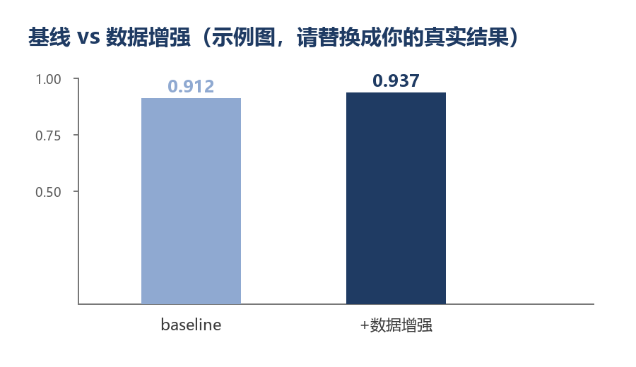

# C++ 练习与 AI 小实验

人工智能学院大一的学习仓库：课程练习、刷题记录、以及暑假做的一个小实验。
代码按周组织，每个文件夹都能独立编译运行。



## 结果

| 方法 | 准确率 |
|---|---|
| baseline | 0.912 |
| +数据增强 | 0.937 |

> 上图为占位示例，替换成你自己的实验结果（把图片放进 `docs/`，文件名保持一致即可）。

## 运行环境

- Windows 10/11
- g++ 13（MinGW-w64）或 MSVC 2022
- Python 3.11 + PyTorch 2.x（仅 `experiments/` 下需要）

## 快速开始

```bash
# 编译并运行第一个程序
g++ src/hello.cpp -o hello
./hello

# Python 实验（可选）
pip install -r requirements.txt
python experiments/train.py --epochs 10
```

## 目录

```
.
├── src/                C++ 练习源码
├── experiments/        Python / PyTorch 小实验
├── docs/               截图、报告、图
├── README.md           本文件
└── .gitignore          忽略编译产物、虚拟环境、数据
```

## 进度

| 周次 | 主题 | 状态 |
|---|---|---|
| 1 | 环境与第一行代码 | 完成 |
| 2 | 变量、类型与表达式 | 完成 |
| 3 | 流程控制 | 进行中 |

## 参考

- [cppreference](https://zh.cppreference.com/)
- 《C++ Primer》第 5 版
